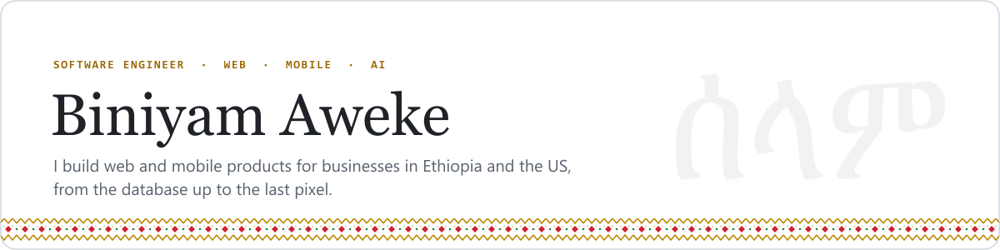
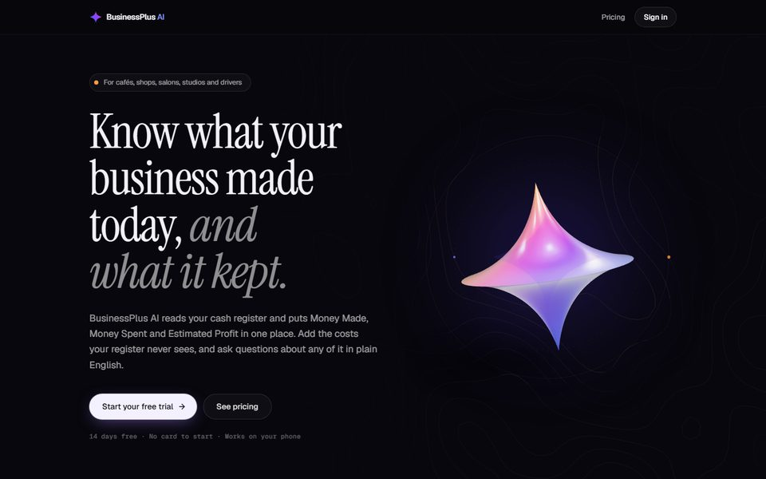
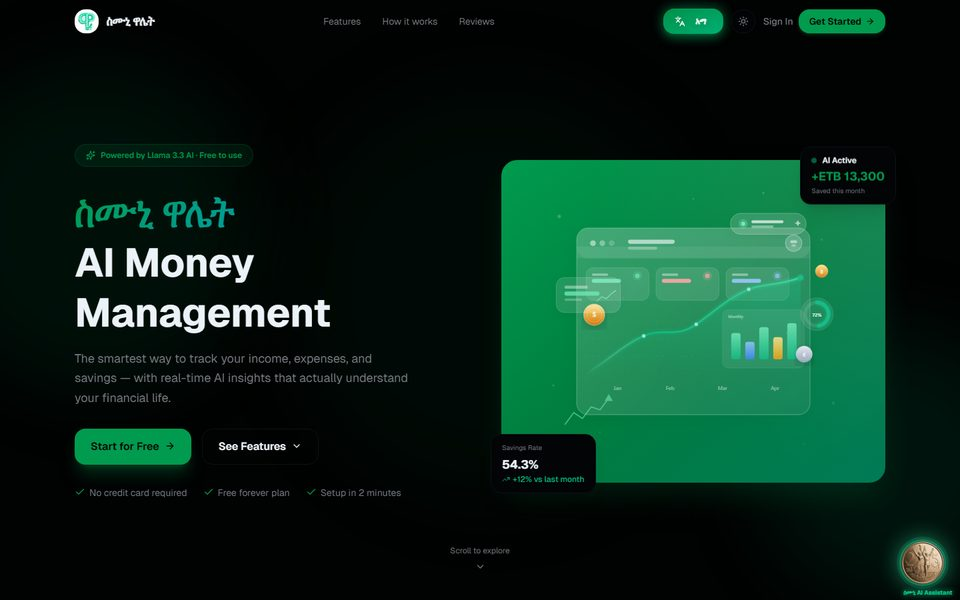
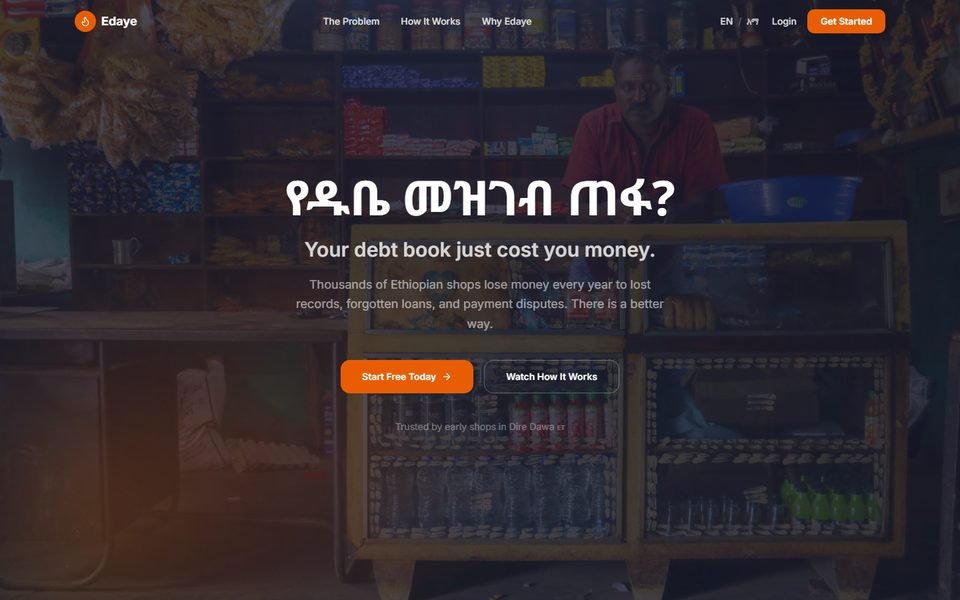
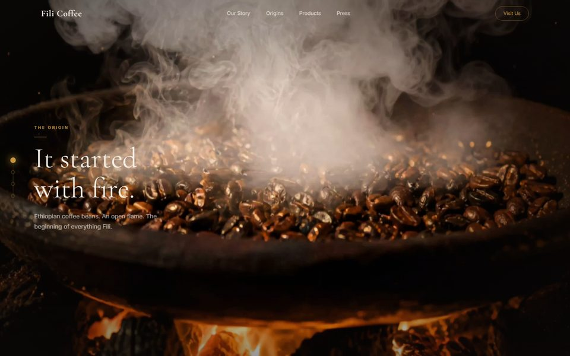

<picture>
  <source media="(prefers-color-scheme: dark)" srcset="assets/banner-dark.svg">
  
</picture>

I'm a software engineer and co-founder of **Vibey World**, a small studio in Ethiopia. Most weeks I'm switching between a Next.js dashboard, a Flutter app and a Node backend, often for the same product. I care about boring infrastructure, honest numbers, and screens that make sense to a shop owner, not just to other developers.

**Right now**

- Building **BusinessPlus AI**, which plugs into a café's or shop's POS and answers "how did we do this week?" in plain English, using Claude
- Shipping updates to **Lomi**, a dating app on Google Play (Flutter, Node, AWS)
- Building **Vibey Gift**, branded gift cards for Ethiopian coffee shops, with a staff app for the counter

## Selected work

<table>
<tr>
<td width="50%" valign="top">

<h3>BusinessPlus AI</h3>

Sales dashboards and an AI assistant for small US businesses, fed by Square. The assistant calls read-only tools that return already-formatted money, so the model never does arithmetic and can't reach another business's data.

Next.js · Prisma · Postgres · Claude API · Stripe · Square · Sentry · Playwright
  
</td>
<td width="50%" valign="top">

<h3>ስሙኒ Wallet</h3>

Personal finance in birr, in Amharic or English. Track spending, set goals, and ask an assistant (Llama 3.3 on Groq) why the month went the way it did. Live notifications over SSE.

Next.js · Express · MongoDB · Groq · JWT + OTP
  
</td>
</tr>
<tr>
<td width="50%" valign="top">

<h3>Edaye (እዳዬ)</h3>

Replaces the paper <i>dube</i> notebook that shop owners use to track customer credit. Loans can be recorded by voice in Amharic, and both sides confirm by email, so arguments end before they start.

Next.js · Supabase · Postgres · Resend
  
</td>
<td width="50%" valign="top">

<h3>Fili Coffee</h3>

A scroll-driven brand site for an Ethiopian coffee roaster: the story moves from fire to cup as you scroll. Same approach as the <a href="https://v0-holland-dairy-website.vercel.app">Holland Dairy</a> redesign (152-frame canvas + a Gemini chat helper).

Next.js · Tailwind · GSAP · Canvas
  
</td>
</tr>
</table>

**Also shipped**

- **Lomi**: a Flutter dating app with a TypeScript backend of about 30 modules. Real-time chat over Socket.IO, subscriptions through RevenueCat, push via Firebase, media on S3, and every photo checked by AWS Rekognition before it's stored. iOS builds go out through Codemagic.
- **Vibey Gift**: multi-tenant gift card infrastructure. A Next.js API and dashboards, plus an Expo (React Native) app that staff use to scan and load cards. Tests cover concurrency, idempotency and merchant isolation.
- **[Addis Hiwot School](https://ahs.vibeyworlds.com)**: a bilingual Astro site with a Supabase admin and PDF uploads to Backblaze B2.
- **[Awaqi](https://awaqi-membership-portal.vercel.app)** membership portal, **[PowerGym](https://powergym-kappa.vercel.app)** gym management, and **[QR Wedding Gallery](https://wedding-gallery-app-three.vercel.app)** for wedding studios.

**On the data side:** [solar site analysis](https://github.com/Biniaweke21/solar-energy-analytics-1) on 1.6M rows of sensor data from Benin, Togo and Sierra Leone (Streamlit dashboard), [news sentiment vs. stock moves](https://github.com/Biniaweke21/nova-financial-insights-), and an [end-to-end ML pipeline](https://github.com/Biniaweke21/End-to-End-Machine-Learning-Project) served with Flask.

## What I work with

| | |
|---|---|
| **Web** | TypeScript, React, Next.js, Tailwind, Astro, Vite |
| **Mobile** | Flutter (GetX), React Native with Expo |
| **Backend** | Node.js, Express, Socket.IO, Bull, REST, webhooks |
| **Data** | PostgreSQL, Prisma, Supabase, MongoDB |
| **Cloud** | Vercel, AWS (S3, Rekognition), Firebase, Render, Backblaze B2, Docker, GitHub Actions, Codemagic |
| **AI** | Claude API (tool use), OpenAI SDK, Groq / Llama, Gemini |
| **Payments & email** | Stripe, RevenueCat, Square, Resend, Brevo |
| **Python** | pandas, scikit-learn, XGBoost, NLTK, Streamlit, Flask |

## Background

**Co-founder, Vibey World** · 2025 to now. We design and build products for businesses, mostly in Ethiopia. 
**Data Scientist, ConDigital** · Mar to Apr 2026. Trained and evaluated AI agents on data science work (EDA, modelling, visualization). 
**B.Sc. Software Engineering, Haramaya University** · 2025

Most of my client work lives in private repos, so the live links above are the best way to see it.

**Say hi:** [biniaweke2194@gmail.com](mailto:biniaweke2194@gmail.com) · [LinkedIn](https://linkedin.com/in/biniyam)
