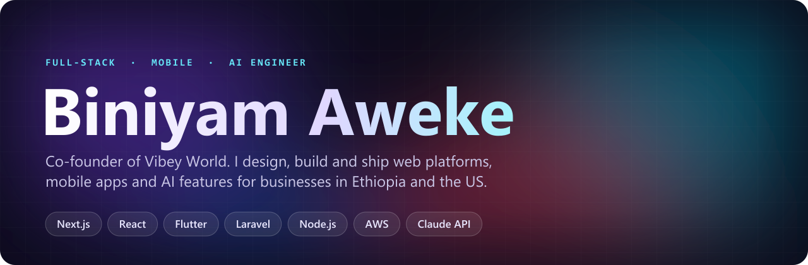

  
  
  
  

## About me

I'm a software engineer from Ethiopia and co-founder of **[Vibey World](https://vibeyworlds.com)**, an Ethiopian technology company. I lead projects from the first client call to the production release: architecture, database design, backend, web, mobile, deployment and the support that comes after launch.

My work is split between clients at home and abroad. For US-based clients I've built a SaaS analytics product, a booking platform for a hair salon in Maryland, and a dating app for the Ethiopian and Eritrean diaspora. At home I build tools for shops, schools and service businesses, often in both English and Amharic.

What I bring to a project:

- **End-to-end ownership.** I take a product from idea to live: schema, APIs, admin dashboards, customer-facing apps, hosting, CI and app store releases.
- **Web and mobile in one team.** Next.js and Vue for the web, Flutter and React Native for phones, Node.js and Laravel behind them.
- **AI that is useful and safe.** Assistants built on the Claude, OpenAI, Gemini and Groq APIs, designed so the model can't touch data it shouldn't and can't make up numbers.
- **Systems that hold up in production.** Multi-tenant isolation, payments and subscriptions, role-based access, background jobs, real-time chat and automated tests where money or bookings are involved.

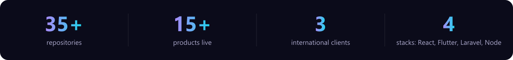

## Tech stack

<table>
<tr><td><b>Frontend</b></td><td></td></tr>
<tr><td><b>Mobile</b></td><td> &nbsp;Flutter · React Native (Expo)</td></tr>
<tr><td><b>Backend</b></td><td></td></tr>
<tr><td><b>Databases</b></td><td></td></tr>
<tr><td><b>Cloud &amp; DevOps</b></td><td></td></tr>
<tr><td><b>AI</b></td><td>

</td></tr>
<tr><td><b>Payments &amp; services</b></td><td>

</td></tr>
</table>

## Featured projects

### 1. BusinessPlus AI
 

<a href="https://business-plus-one.vercel.app">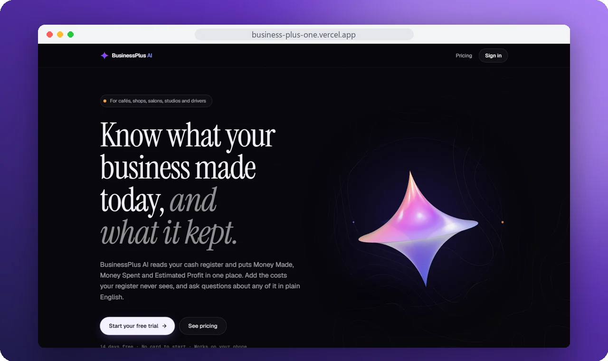</a>

A subscription web app for small US businesses such as cafés, shops, salons and truck drivers. It connects to the cash register, pulls in every sale, and turns them into dashboards and reports from hourly to yearly. Owners add the costs the register never sees, like rent, supplies and fuel, by typing or by voice, so they get **Money Made, Money Spent and Estimated Profit** in one place.

- An **AI assistant on the Claude API** answers questions like "how did we do this week?" in plain English. Its tools are read-only and return numbers already formatted, so the model never does arithmetic and has no way to reach another business's data.
- Square integration with webhooks and scheduled syncs, plus a manual, voice and CSV mode for businesses without a POS.
- Stripe subscriptions, magic-link sign-in, installable PWA with push alerts, PDF and Excel exports.
- Unit, database and end-to-end tests (Vitest, Playwright) in CI. Errors are tracked with Sentry.

       

---

### 2. Lomi: Habesha dating app
 

<a href="https://play.google.com/store/apps/details?id=com.lomi_dating">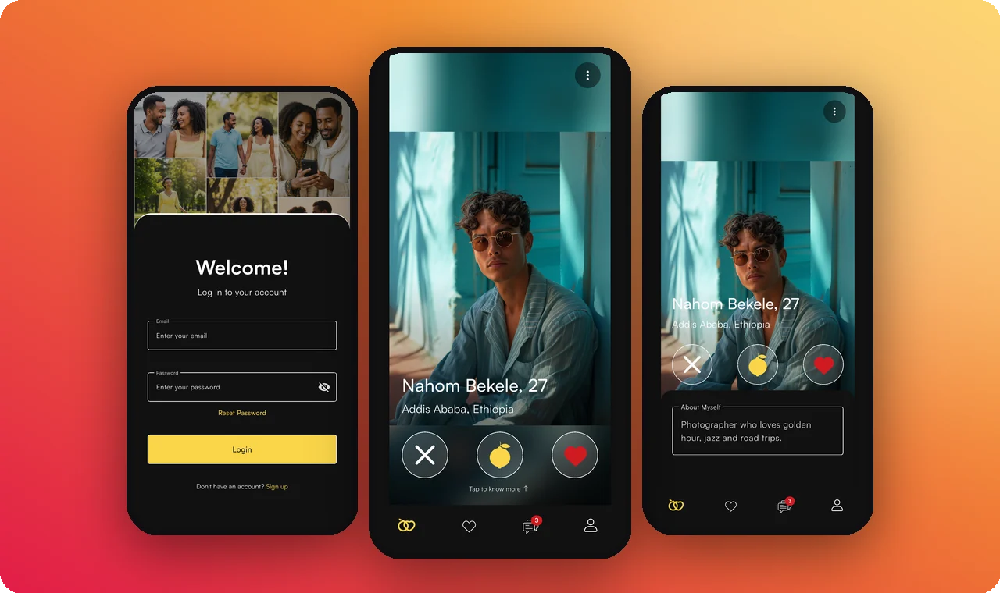</a>

A dating app for Ethiopian and Eritrean singles around the world. I took the project over and brought it to launch: the Flutter app, a Node.js backend of about 30 modules, an admin dashboard, and the store releases.

- **Real-time chat** over Socket.IO, with voice notes, media and consent-based messaging.
- **Every uploaded photo is moderated automatically** by AWS Rekognition before it is stored, to meet the App Store and Google Play content rules.
- **In-app purchases and subscriptions** through RevenueCat: super likes, profile unlocks and a recurring premium plan.
- Push notifications (Firebase), media on S3, background jobs (Bull) and an admin dashboard (React, Ant Design).
- Runs on AWS EC2 and MongoDB Atlas. iOS builds go through Codemagic, with a GitHub Actions CI gate on the backend.
- Hardening work: removed hardcoded secrets, added database indexes, fixed silent crash and CORS issues, and cleaned leaked credentials out of the git history.

       

 

---

### 3. Beauty by Josey: salon booking system

<a href="https://github.com/Biniaweke21/josey-hair-booking">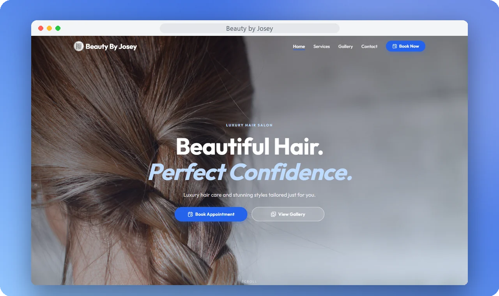</a>

A website and booking system for a hair braiding salon in Maryland. Booking braids is harder than it looks: the same style takes very different amounts of time depending on length, size and add-ons. The system works out those durations and **only offers time slots that really fit**.

- A six-step booking flow: category, service, date, time, details, review.
- Services with variation types (length, size) that each change price and duration, plus add-ons.
- An availability engine built on business hours, one-off closures, each stylist's weekly schedule and leave, and capacity.
- An admin dashboard for bookings, customers, employees, gallery, notification templates and logs, reports and settings.
- Roles and permissions with spatie/laravel-permission.

     

---

### 4. Vibey Leads: agency CRM

<a href="https://github.com/Biniaweke21/vibey-leads-crm">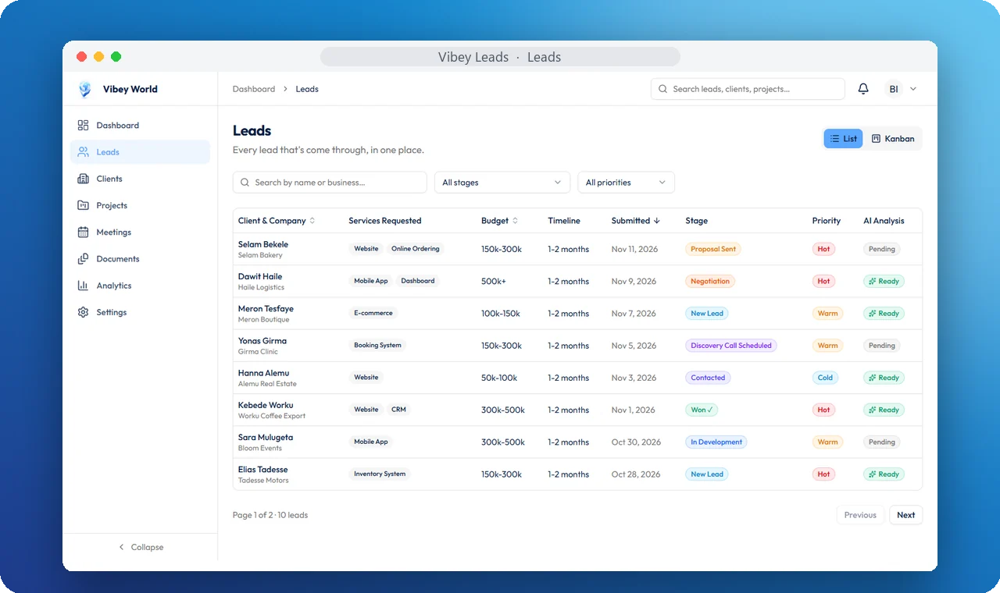</a>

The CRM my company runs on. It follows every deal from first contact to delivery: a lead fills in the request form, moves through a ten-stage pipeline, becomes a client, and turns into a project with its own documents, meetings and reminders. Clients get a **separate portal** where they follow progress and download files.

- **AI lead analysis and one-click proposal drafts** with Gemini, so every new lead comes with an analysis and a proposal draft ready to edit.
- Proposals, contracts and invoices, generated as PDFs.
- Analytics: revenue trend, lead pipeline, conversion and collection rates, revenue by client, team performance.
- Kanban and list views, team roles (admins see revenue, team members don't), and Google Calendar sync.
- A typed Vue 3 SPA on a Laravel 12 REST API with Sanctum auth and a single response envelope.

      

---

### 5. Vibey Gift: gift card platform

<a href="https://web-sepia-rho-poujm9v2xj.vercel.app">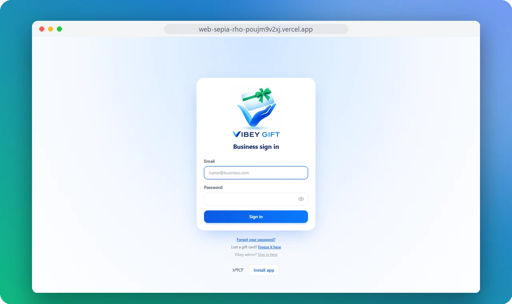</a>

Shared infrastructure that lets independent coffee shops run **their own branded physical gift cards**. Every merchant's cards, staff and transactions are kept fully separate, and there is exactly one source of truth for each card's balance.

- A **React Native (Expo) staff app** for the counter: scan a card's QR code, load it, or charge a purchase.
- Merchant dashboard and Vibey admin dashboard on Next.js, with QR and PDF card generation.
- Tests for the parts where money moves: fill and buy validation, concurrent requests, idempotency, and merchant isolation.
- A monorepo with types shared between the web and mobile apps.

    

## More work

<table>
<tr>
<td width="50%" valign="top">
<a href="https://v0-loan-tracking-app-omega.vercel.app">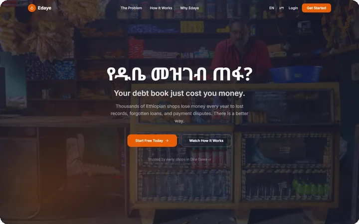</a>
<b>Edaye (እዳዬ)</b>: digital credit book for small shops. Loans are recorded by voice in Amharic and confirmed by both sides. Next.js · Supabase
</td>
<td width="50%" valign="top">
<a href="https://simuni-wallet.vercel.app">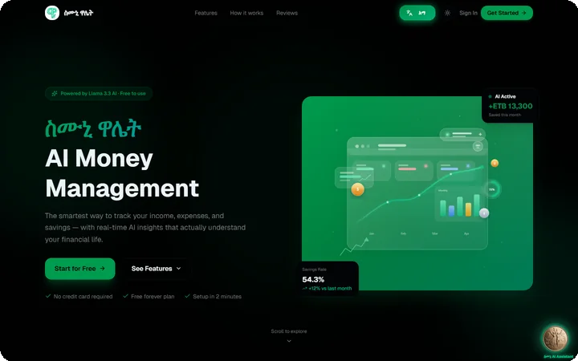</a>
<b>ስሙኒ Wallet</b>: personal finance in birr, with an AI assistant on Llama 3.3 (Groq) and live notifications. Next.js · Express · MongoDB
</td>
</tr>
<tr>
<td width="50%" valign="top">
<a href="https://fili-coffee-website.vercel.app">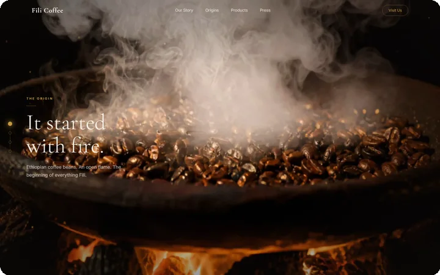</a>
<b>Fili Coffee</b>: a scroll-driven brand story for an Ethiopian coffee roaster. Next.js · GSAP · Canvas
</td>
<td width="50%" valign="top">
<a href="https://ahs.vibeyworlds.com">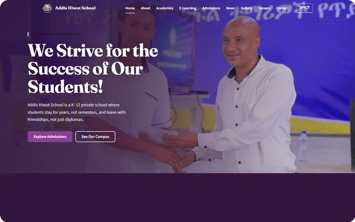</a>
<b>Addis Hiwot School</b>: a bilingual school website with an admin panel and e-learning uploads. Astro · Supabase · Backblaze B2
</td>
</tr>
</table>

Also: [Holland Dairy](https://v0-holland-dairy-website.vercel.app) (152-frame scroll animation + Gemini assistant) · [Awaqi](https://awaqi-membership-portal.vercel.app) membership portal · [PowerGym](https://powergym-kappa.vercel.app) gym management · [QR Wedding Gallery](https://wedding-gallery-app-three.vercel.app) for wedding studios

**Data science:** [solar investment analysis](https://github.com/Biniaweke21/solar-energy-analytics-1) on 1.6M rows of sensor data (Streamlit) · [financial news sentiment vs. stock prices](https://github.com/Biniaweke21/nova-financial-insights-) · [end-to-end ML pipeline](https://github.com/Biniaweke21/End-to-End-Machine-Learning-Project) served with Flask

## Experience

| Role | Where | When |
|---|---|---|
| **Co-founder & Lead Engineer** | [Vibey World](https://vibeyworlds.com), Ethiopia | 2025 to present |
| **Data Scientist** | ConDigital: trained and evaluated AI agents on data science work | Mar to Apr 2026 |
| **Freelance Software Engineer** | Web, mobile and AI projects for clients in Ethiopia and the US | 2025 to present |

**Education:** B.Sc. in Software Engineering, Addis Ababa University, CGPA 3.92/4.00

## Let's work together

I'm open to freelance and contract work, especially SaaS products, mobile apps and AI features that need to be built properly from day one. Most of my client code is private, so the fastest way to see what I can do is the live links above, or a quick call.

  
  

